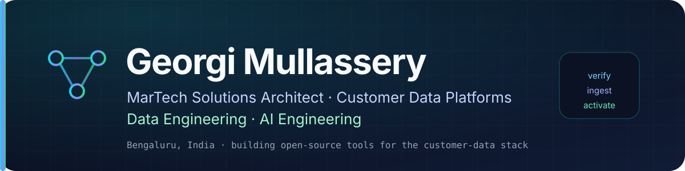

  

# Georgi Mullassery

**MarTech Solutions Architect** · Customer Data Platforms · Data Engineering · AI Engineering
Bengaluru, India

I build open-source tools for the parts of the customer-data stack that break quietly: tags that stop firing, consent that does not actually block, CRM data that drifts, and scripts that tax every page.

[Start here](#start-here) · [Open source](#open-source-by-category) · [Technologies](#technologies-i-work-with) · [Contact](#contact)

## Start here

| Project | What it does |
|---|---|
| **[PyTagManager](https://github.com/Mullassery/PyTagManager)** | Debug why GTM tags do not fire. Inspects containers, correlates runtime DOM → dataLayer → GTM → network in a real browser, audits consent and script performance, and generates reviewable fixes. [PyPI](https://pypi.org/project/pytagmanager/) |
| **[QuillSift](https://github.com/Mullassery/QuillSift)** | Rust-native, self-hosted scraping engine: SSRF-guarded fetching, deterministic HTML → Markdown/text/JSON, and schema-validated LLM extraction (OpenAI-compatible + Ollama). [PyPI](https://pypi.org/project/quillsift/) |
| **[PyTagShield](https://github.com/Mullassery/PyTagShield)** | Consent-aware, privacy-minimizing event pipeline with a Rust core and Python API. Validate, pseudonymize, minimize, and route events to GA4, Meta CAPI, PostHog, sGTM, or webhooks. [PyPI](https://pypi.org/project/pytagshield/) |
| **[Squid-CRM](https://github.com/Mullassery/Squid-CRM)** | Self-hostable CRM backend, API-compatible with Twenty. Rust + Axum + PostgreSQL + GraphQL/REST, multi-tenant, RBAC, custom objects, webhooks. Alpha. |

Also worth a look: **[OmniPilot](https://github.com/Mullassery/OmniPilot)** — verification-first mobile automation with evidence-backed results and an MCP server · **[TinyBridge](https://github.com/Mullassery/TinyBridge)** — a macOS-native Linux VM runtime that boots a real Ubuntu guest on Apple's Virtualization.framework · **[PyStreamXL](https://github.com/Mullassery/PyStreamXL)** — constant-memory Excel streaming with a Rust core.

## What I'm focused on

- **Measurement you can verify.** Tags, dataLayer contracts, consent, and the gap between "the tag fired" and "the event arrived correctly."
- **Customer data that stays usable.** Identity, segmentation, reverse ETL, and the pipeline reliability that CDPs depend on.
- **Local-first tooling.** Diagnostics that run on your machine, with honest confidence labels instead of fabricated certainty.

## About me

Solutions Architect with more than a decade of experience across IBM, Wipro, IPG Mediabrands, and others, designing and delivering enterprise-scale customer data, marketing technology, analytics, and AI-enabled solutions. Expertise in Customer Data Platforms (Adobe RT-CDP, Braze, mParticle, Segment CDP), event-driven architectures, cloud data platforms, customer journey orchestration, identity resolution, real-time activation, and data engineering on Google Cloud and Azure.

Outside of MarTech, I build systems-level software in Rust for fun, including a from-scratch AI-native OS kernel (the SHER OS family).

- **Background:** MBA, Jansons School of Business · B.Com, Mar Ivanios College
- **Exploring:** agentic AI for MarTech workflows, RAG architectures, and MCP-based agent tooling

## Open source, by category

Every project links straight to its **Use Cases** section where one exists — the fastest way to see whether it solves a problem you actually have. Status is stated plainly: if something is early-stage or has known gaps, the README says so.

> **Not sure which project you need?** Several tools share deliberately similar names — the `Py*Guard`, `Py*Check`, `Py*Hound`, and `Py*Mesh` families. Each of those repos opens with a short **"Which project do I need?"** table that maps common problems to the right tool.

### MarTech & Customer Data

| Repo | What it does |
|---|---|
| [PyTagManager](https://github.com/Mullassery/PyTagManager#use-cases) | Debugs GTM implementations: container analysis, semantic DOM graph and tracking recommendations, real-browser runtime diagnosis, site-wide tagging QA, data dictionary, tag execution graph and test candidates, consent audit, and controlled script-impact experiments. |
| [PyTagShield](https://github.com/Mullassery/PyTagShield) | Consent-aware, privacy-minimizing server-side event pipeline with a Rust core: validation, pseudonymization, data minimization, and destination routing (GA4, Meta CAPI, PostHog, sGTM, webhooks). |
| [ClusterAudienceKit](https://github.com/Mullassery/ClusterAudienceKit#who-its-for) | Rust-powered customer segmentation: RFM, KMeans/K-Prototypes with automatic K selection, churn/CLV, lookalikes, cohorts, drift detection, streaming segmentation, SQL export to 8 dialects, differential privacy/k-anonymity, and revenue/price intelligence. |
| [PyReverseETL](https://github.com/Mullassery/PyReverseETL#who-its-for) | Real reverse ETL with Postgres/MySQL/S3/webhook and Salesforce/HubSpot/Marketo/Squid-CRM connectors, PII masking, validation gates, retry/idempotency, and a queryable lineage graph. |
| [PyCustomerHub](https://github.com/Mullassery/PyCustomerHub#who-its-for--use-cases) | Self-hosted CDP and engagement platform: identity resolution with provenance, real-time audiences, governance and consent-aware activation, durable journeys, Postgres + Kafka, and Web/iOS/Android/JS/Python SDKs. |
| [Squid-CRM](https://github.com/Mullassery/Squid-CRM) | Self-hostable CRM backend, API-compatible with Twenty. Multi-tenant, RBAC, custom objects, GraphQL/REST, and webhooks. Alpha; the frontend is not vendored. |

**These projects are complementary by design** — each is useful on its own, but together they cover a customer-data lifecycle end to end:

- **PyTagManager** — the **measurement** layer: implements and runtime-verifies the analytics tags that generate the events.
- **PyTagShield** — the **consent and routing** layer: minimizes what leaves the browser and controls which destinations receive it.
- **PyCustomerHub** — the **ingestion and engagement** layer: resolves identity, evaluates audiences in real time, governs activation, and runs durable journeys across Web, iOS, Android, JS, and Python SDKs.
- **ClusterAudienceKit** — the **intelligence** layer: turns raw data into segments with RFM analysis, clustering, and churn/CLV scoring.
- **PyReverseETL** — the **activation** layer: pushes segments to CRM and marketing-automation destinations with PII masking and lineage.
- **Squid-CRM** — the **system of record** layer: a self-hostable CRM backend for the data the rest of the stack activates into.

The stack reads as one round trip: **verify capture → enforce consent → ingest → segment → activate → land in CRM** — and each project is built to snap into the others rather than compete with them.

### Web data & extraction

| Repo | What it does |
|---|---|
| [QuillSift](https://github.com/Mullassery/QuillSift) | Rust-native, self-hosted scraping: SSRF-guarded fetching, MudFish-backed crawling, deterministic HTML → Markdown/text/JSON, schema-validated LLM extraction, Python bindings, and a CLI. |
| [MudFish](https://github.com/Mullassery/MudFish#who-its-for--use-cases) | Rust-native async crawler: bounded budgets, post-resolution SSRF protection, robots.txt and per-host politeness, resumable crawls, and opt-in headless-Chrome rendering; Python bindings via PyO3. |

### Data Pipeline Reliability & Quality

| Repo | What it does |
|---|---|
| [PyAirflowTester](https://github.com/Mullassery/PyAirflowTester#who-its-for--use-cases) | Static analysis for Airflow DAGs, dbt manifests, and `airflow.cfg` (33 rules) with a unified dependency graph, blast-radius/risk scoring, SARIF/JSON/HTML output, an optional dashboard, and OpenLineage runtime ingestion. |
| [StatGuardian](https://github.com/Mullassery/StatGuardian#who-its-for--use-cases) | Runtime data contracts in a declarative `.sg` DSL: schema validation, PSI/KS drift detection, anomaly checks, blocking severity tiers, Pandas/Polars/Delta/Iceberg inputs, and a Rust core. |
| [PyBeamGuard](https://github.com/Mullassery/PyBeamGuard#who-its-for--use-cases) | Static pre-flight analysis for Apache Beam, Flink, and Spark pipelines: 10 Beam analyzers plus Flink/Spark checks for hot keys, shuffle, state, checkpointing, windowing, join strategy, cost, and reliability, with YAML rules and CI gating. |
| [PyDBTGuard](https://github.com/Mullassery/PyDBTGuard#who-its-for--use-cases) | Pre-deployment dbt test intelligence from `manifest.json`/`run_results.json`: risk scoring, historical failure prediction, blast-radius mapping, coverage audits, cost estimates, diagnostics, and opt-in local SQLite/DuckDB/Postgres query checks. |
| [PyDependencyCheck](https://github.com/Mullassery/PyDependencyCheck#who-its-for--use-cases) | Python dependency intelligence: OSV vulnerability scanning, Git provenance (`why`/`trace`), unused-package detection, license compliance, health scoring, CI gating, and signed CycloneDX/SPDX SBOMs. |
| [PyDeepMesh](https://github.com/Mullassery/PyDeepMesh) | Multi-ecosystem dependency-graph, vulnerability, and attack-surface intelligence (Python, Rust, Node, containers) — manifests, lockfiles, Dockerfiles, Syft image scans, offline/live OSV matching, HTML graphs, SARIF + CycloneDX SBOMs. Static analysis only; never executes your code. |
| [PyNetworkIntel](https://github.com/Mullassery/PyNetworkIntel#who-its-for--use-cases) | LAN discovery and vulnerability intelligence built on `nmap -sV`: topology graphs (GraphML/d3), NVD CVE checks, optional SSH config capture, change tracking, NetBox export, Nuclei verification, reports/alerts, and an optional AI summary. |
| [PyTaskWireCheck](https://github.com/Mullassery/PyTaskWireCheck) | Local-first, dependency-aware task orchestration: DAG scheduling with bounded concurrency, content-addressed cache, retries, watch mode, SQLite run history, webhooks, and a CLI/TUI/Python API. No server, no daemon. |
| [PyStreamXL](https://github.com/Mullassery/PyStreamXL#who-its-for--use-cases) | Streams multi-sheet `.xlsx` files row-by-row in constant memory (Rust-backed), with streaming writes/appends, formula/comment extraction, conditional formatting, formula-cycle validation, and an optional REST server. |
| [PySynthData](https://github.com/Mullassery/PySynthData#who-its-for--use-cases) | Generates synthetic relational datasets from a schema with referential integrity, constraint enforcement, differential-privacy noise, streaming generation, quality scoring, schema inference, and Parquet/JSON/Pandas export. |
| [PyWeatherEnriched](https://github.com/Mullassery/PyWeatherEnriched#who-its-for) | Geocodes a location and fetches real observed historical weather, then engineers climate features (degree-days, rolling stats, anomaly z-scores, offline normals), with backfill, two-tier caching, OSM reverse geocoding, and urban-heat estimates. |

### LLM & AI Tooling

| Repo | What it does |
|---|---|
| [PyTokenCalc](https://github.com/Mullassery/PyTokenCalc#who-its-for--use-cases) | Token counting and cost estimation across OpenAI, Anthropic, Google, Cohere, Azure, HuggingFace, Ollama, and custom endpoints — with streaming/incremental counts, pricing overrides and drift warnings, and an optional MCP server. |
| [PyInferenceManager](https://github.com/Mullassery/PyInferenceManager#who-its-for) | Multi-provider inference orchestrator (Anthropic, OpenAI, Gemini, OpenRouter, Ollama, vLLM) with complexity/privacy/cost routing, hard budget caps, retries/backoff, semantic caching, concurrent and async calls, hardware profiling, and MCP tools. |
| [PyStreamMCP](https://github.com/Mullassery/PyStreamMCP#who-its-for--use-cases) | Query planning, source discovery, and context optimization for AI agents — Python SDK, REST API, MCP tool server, multi-endpoint orchestration, framework adapters, and an HMAC-signed webhook event endpoint. |
| [PyContextFold](https://github.com/Mullassery/PyContextFold) | Local-first, structure-aware context optimization for LLMs (Rust core + Python/CLI): folds source code, docs, logs, and structured text into compact representations, with token budgets, repository packing, deterministic profiles, and loss always labeled. |
| [PyVectorHound](https://github.com/Mullassery/PyVectorHound#who-its-for) | Diagnostic layer for RAG pipelines: embedding-space and retrieval metrics, BM25/reranker diagnostics, LLM-judge faithfulness checks, root-cause recommendations, drift tracking, batch evaluation, HTML/JSON reports, and opt-in int8 quantization. |
| [PyAgentHound](https://github.com/Mullassery/PyAgentHound#who-its-for--use-cases) | Local-first AI-agent debugger: OpenTelemetry-compatible traces in SQLite, a causal execution graph, deterministic failure rules, ranked root causes, baseline diffs, safe replay, trace-based regression tests, a web UI, and optional Ollama explanations. |
| [PyStreamPDF](https://github.com/Mullassery/PyStreamPDF#who-its-for--use-cases) | PDFium-backed PDF parsing with token-budget-aware semantic chunking, dual-tier signed caching, encrypted-PDF permission handling, OCR/validation pipelines, exact or heuristic token counts, and an optional local MCP connector. |
| [PyAPICheck](https://github.com/Mullassery/PyAPICheck#who-its-for--use-cases) | API security discovery and authorization analysis: OpenAPI linting, Schemathesis active testing, spec drift, observed-vs-declared traffic checks, MCP/agent security graphs, behavioral baselining, Cedar policy generation, SARIF output, and remediation plans. |
| [PyStreamAI](https://github.com/Mullassery/PyStreamAI#who-its-for--use-cases) | ML deployment toolkit: canary/A-B routing, cost tracking and budgets, request scheduling, hot model reload, HTTP serving, ONNX Runtime inference, model-registry integrations, and real train/serve abstractions. |
| [PyInterviewBot](https://github.com/Mullassery/PyInterviewBot#who-its-for) | Voice-first AI interview platform: Rust WebSocket gateway, Python ASR/LLM/TTS engine, and candidate/recruiter client. Runs entirely on local faster-whisper, Ollama, and Piper models; adaptive evidence graph, resume/JD rubrics. Early-stage. |
| [OpenAnchor](https://github.com/Mullassery/OpenAnchor#who-its-for--use-cases) | In-process LLM token intelligence: 6D usage attribution, LangChain middleware, SQLite/in-memory stores, semantic caching, cost governance, and real OpenTelemetry span export. Privacy-safe defaults. |
| [PyBlastRadius](https://github.com/Mullassery/PyBlastRadius) | Dependency-graph blast-radius analysis, criticality scoring, and failure-cascade simulation, with real parsers for Terraform, Kubernetes manifests, and OTLP traces, plus a CLI, REST API, and Graphviz export. Airflow discovery is still roadmap. |

### Systems & Runtimes

| Repo | What it does |
|---|---|
| [TinyBridge](https://github.com/Mullassery/TinyBridge#who-its-for--use-cases) | macOS-native Linux VM runtime on Apple's Virtualization.framework: real Ubuntu guest boot, VirtioFS directory sharing, snapshots, port forwarding, cloud-init seeding, and a daemon/CLI. The macOS backend is real and working; Windows/Linux backends are unimplemented scaffolding. Installed via [Homebrew tap](https://github.com/Mullassery/homebrew-tinybridge), not PyPI. |
| [TinyBridge-UI](https://github.com/Mullassery/TinyBridge-UI) | Native macOS SwiftUI client for TinyBridge: menu-bar control center, VM management windows, live/observed resource metrics, port-forwarding and config validation, and diagnostics with secret redaction. |
| [PrismNote](https://github.com/Mullassery/PrismNote#who-its-for--use-cases) | Jupyter-compatible data-science notebook: Rust/Axum backend, React frontend, 15+ code languages, SQL against local engines and 9+ databases (including 8 cloud warehouses), Docker-sandboxed execution, integrated Claude/OpenAI/Ollama assistance, and semantic notebook diff/merge. Installed via PyPI or [Homebrew tap](https://github.com/Mullassery/homebrew-prismnote). |
| [CodeAtlas](https://github.com/Mullassery/CodeAtlas) | Rust-native architecture maps for codebases — deterministic tree-sitter analysis across Python, Rust, Go, JS/TS, Java, PHP, and C#, component grouping, call-graph queries, PR architecture diffs, incremental caching, and Markdown/Mermaid/HTML/MDX/RST output. Optional LLM naming/descriptions. |
| [PyPerfGuard](https://github.com/Mullassery/PyPerfGuard) | Native benchmark runner and performance-regression guard (Rust): measures wall-clock and resource usage, compares against baselines and Git revisions, reports outliers, tracks local history, integrates with GitHub Actions, and enforces configurable regression policies in any CI — no hosted service. |

### SHER OS — an AI-native operating system, built from scratch (Rust)

A multi-repo, in-development OS project outside the MarTech day job. Most subsystems are currently a deliberate **simulation layer** — real Rust code with real tests, but in-memory/userspace behavior rather than real hardware I/O or a bootable kernel. Each repo's README states plainly what is real vs. simulated.

| Repo | What it does |
|---|---|
| [SHER-KERNEL](https://github.com/Mullassery/SHER-KERNEL#who-its-for--use-cases) | Userspace kernel prototype — 40 Rust crates covering a capability-based object model, priority scheduling, tiered memory bookkeeping, driver lifecycle/crash recovery, A/B transactional updates, zero-copy IPC, an AI subsystem, and Linux/POSIX name-level compatibility. Not bootable; simulation-backed. |
| [SHER-Graphics](https://github.com/Mullassery/SHER-Graphics#who-its-for--use-cases) | GPU abstraction and rendering — pure-Rust software GPU simulation with a capability-secured runtime, plus a real ash/Vulkan FFI backend verified against MoltenVK; Mesa/OpenGL compatibility is planned. |
| [SHER-Display](https://github.com/Mullassery/SHER-Display#who-its-for--use-cases) | Native display server, compositor, and window manager: damage-tracking compositor, per-output frame scheduling, scene graph, workspaces, focus/cursor routing, capability-based security, explicit session state, and Wayland/XWayland compatibility seams. Not yet a usable desktop. |
| [SHER-INPUT](https://github.com/Mullassery/SHER-INPUT#who-its-for--use-cases) | Canonical, backend-independent input event stream: real Linux/evdev backend, keyboard/pointer/touch/tablet/gamepad event model, global sequencing, capture and synthetic-input contracts, crash detection, and a hardware-free test harness. |
| [SHER-Aurora](https://github.com/Mullassery/SHER-Aurora#who-its-for--use-cases) | GNOME-style Rust design system: tokens, typography, Light/Dark/OLED/HDR themes, spring motion, sound events, 24 icons, automated WCAG contrast auditing, and 5 of 17 planned GTK4 widgets rendering real objects today. |
| [SHER-Process-Explorer](https://github.com/Mullassery/SHER-Process-Explorer#who-its-for--use-cases) | Evidence-based Linux process investigation: hand-rolled `/proc` parsing, strace/perf/bpftrace tracing, process intelligence, deterministic "why" findings, log/crash correlation, SQLite history daemon, `.deb`/`.rpm`/AUR packaging, and an egui desktop UI. |

### Robotics & Simulation

| Repo | What it does |
|---|---|
| [PyRoboFrames](https://github.com/Mullassery/PyRoboFrames#who-its-for--use-cases) | Rust-backed ML dataloader for robot-learning datasets: native LeRobot v3.0, NumPy/Torch/MLX/JAX outputs, zero-copy frames, Apple Silicon hardware video decode, format conversion (HDF5, RLDS, MCAP, ROS 2 bags), and Hugging Face/S3/GCS loading. |
| [PyRoboReplay](https://github.com/Mullassery/PyRoboReplay#who-its-for--use-cases) | Forensic debugging and causal analysis for recorded robot missions: ROS 2 CDR decoding, mission replay/comparison, reality-gap and failure diagnosis, detection gaps, RGB+thermal fusion, Nav2 root-cause checks, and MCAP/Rerun export. |
| [PyRoboSimulator](https://github.com/Mullassery/PyRoboSimulator#who-its-for--use-cases) | Multi-agent world simulator with real MuJoCo physics, procedural warehouse/parking/urban worlds, RGB/depth/LiDAR/thermal sensors, Gymnasium/PettingZoo adapters, and a FastAPI backend with JWT auth/SSE. Gazebo and Isaac Sim backends are not implemented. |
| [PyRoboVision](https://github.com/Mullassery/PyRoboVision#who-its-for--use-cases) | Robot perception toolkit: Kalman + Hungarian multi-object tracking with occlusion handling, trajectory prediction, depth/3D/LiDAR/BEV occupancy utilities, IMU/GPS fusion, bring-your-own detector, ONNX export, and safety-constraint helpers. |
| [PyTerrainMap](https://github.com/Mullassery/PyTerrainMap#who-its-for--use-cases) | Append-only multi-robot terrain store: H3 spatial indexing with confidence decay, HTTP/HTTPS API, terrain/mobility analysis, PostgreSQL persistence, ROS 2 sensor bridge, SLAM/3D reconstruction ops, and Gaussian-splat mapping (partially implemented). |
| [SyncFleet](https://github.com/Mullassery/SyncFleet) | Rust, SQLite-backed peer-to-peer state sync for fleets: mutual-TLS 1.3 with pinned certs and enrollment tokens, version-vector incremental replication, background peer sync with backoff, mDNS discovery, and policy-based conflict resolution (`remote_wins`/`local_wins`/`last_write_wins`/`merge_fields`). Full CRDTs and mDNS interface binding remain roadmap. |

### Browse everything

[All repositories](https://github.com/Mullassery?tab=repositories) · Legacy combined Homebrew tap: [homebrew-formulas](https://github.com/Mullassery/homebrew-formulas) (superseded by the per-project taps above).

## Technologies I work with

<strong>MarTech, data, cloud, AI, and infrastructure stack</strong>

**MarTech & Customer Data Platforms**
Adobe RT-CDP, Braze, mParticle, Segment CDP, customer journey orchestration, identity resolution, real-time activation, Hightouch / Reverse ETL

**Data Warehousing & Engineering**
BigQuery, Snowflake, Databricks (PySpark), Microsoft Fabric, Azure Data Factory, Airbyte / Fivetran, dbt, Apache Airflow, Apache Kafka, Apache Flink (PyFlink), InfluxDB, Telegraf, Datadog

**Cloud & Data Platforms**
GCP, Azure, AWS · Google Cloud Storage, Azure Blob Storage / ADLS, Amazon S3, MinIO

**AI — RAG & Application Development**
LangChain, LangGraph, LlamaIndex, Chainlit / OpenWebUI, LangSmith, DSPy, BM25 + vector similarity + reranking, context engineering, Ragas + DeepEval, Pinecone, Weaviate, ChromaDB, pgvector, Qdrant, Milvus

**AI — Agent Automation**
Temporal, Langflow, n8n + Node.js, FastAPI, Firecrawl, Tavily, SerpAPI, Twilio, Claude Agent SDK, OpenAI Agent SDK, Google Agent SDK, Ollama, scheduled and background agents

**AI — Autonomous Code Generation**
Claude Code, Cursor, Replit, Codex, Hermes Agent, OpenCode, Lovable, OpenRouter

**MCP & Model Platforms**
Model Context Protocol, Hugging Face, AWS Bedrock, Azure AI Foundry, GCP Vertex AI (Model Garden)

**Infrastructure as Code & Containers**
Terraform, Docker, Docker Compose, Azure Kubernetes Service (AKS), NGINX Ingress

**Identity & Security**
Entra ID / Azure AD, Azure Key Vault, Azure AI Search, incoming/outgoing guardrails

**IoT, Messaging & Robotics**
Raspberry Pi 5, ESP32, MQTT (Eclipse / RabbitMQ), Node-RED, AWS IoT Core, AWS IoT SiteWise, CoAP, edge processing, industrial IoT

## How I build

- **State the real status.** READMEs distinguish shipped, planned, simulated, and known-broken work.
- **No fake stubs.** A feature is implemented or removed — not left pretending to work.
- **Show the evidence.** Tests, real browser runs, and confidence labels instead of confident guesses.
- **Keep it local-first.** Diagnostics should run on your machine, without sending telemetry to a service.

Portfolio-wide audits track **confirmed** and **unverified** issues separately. Unverified items stay documented until tested or disproven — they are not dismissed. See the [open issues register](docs/internal/OPEN_ISSUES.md).

## Contact

- **Email:** [mullassery@gmail.com](mailto:mullassery@gmail.com)
- **LinkedIn:** [georgi-mullassery](https://www.linkedin.com/in/georgi-mullassery/)
- **GitHub:** [github.com/Mullassery](https://github.com/Mullassery)
- **Location:** Bengaluru, India

Always happy to talk customer data platforms, marketing data pipelines, tracking/consent audits, or the tooling that makes them reliable.

If a project here saves you time, a star on the repo helps other engineers find it.
